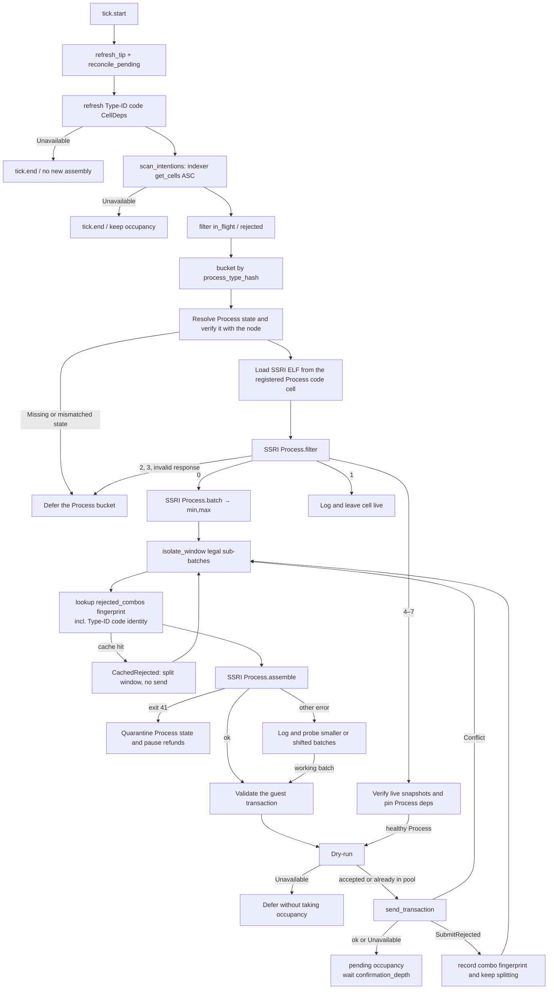

# ckb-cid-backend-server

Public digest daemon for CKB [Common Intention Dispatch (CID)](https://github.com/ashuralyk/ckb-common-intention-dispatcher): scan live Intention cells from the indexer in `asc` order, run SSRI in-process via `cid-process-executor` (ckb-vm) against the live Process binary, assemble and submit Execution Tx.

This repository is **independent** of [`ckb-common-intention-dispatcher`](https://github.com/ashuralyk/ckb-common-intention-dispatcher) (protocol, CID lock, executor, `cid_process_example`). Link them with git dependencies and on-chain conventions — do not merge the monorepos.

The current implementation is the digest loop (v0) plus optional health/metrics HTTP. No admin API, no disk state. Restart = full indexer rescan.

## Docs

- Confirmation depth / reorg / retry: [`docs/confirmation.md`](docs/confirmation.md)
- Logs, health, metrics: [`docs/observability.md`](docs/observability.md)
- Isolated local **dev** chain closure: [`docs/local-dev-chain.md`](docs/local-dev-chain.md)
- Design (historical decisions; some v0 scope was filled in later phases — the code wins): [`docs/superpowers/specs/2026-11-05-cid-backend-server-design.md`](docs/superpowers/specs/2026-11-05-cid-backend-server-design.md)
- Implementation plan: [`docs/superpowers/plans/2026-11-05-cid-backend-server.md`](docs/superpowers/plans/2026-11-05-cid-backend-server.md)
- Real SSRI fixture: [`tests/fixtures/README.md`](tests/fixtures/README.md)

---

## Purpose

The daemon continuously digests CID Intentions:

1. Scan live Intentions by the configured CID code Type ID. The shared `cid-intention-filter` routing helpers validate the CID lock identity and extract the Process state Type ID. Malformed, foreign-CID, and unregistered Intentions remain live.
2. Resolve the registered Process state and code cells by exact Type-ID scripts. The state lock points at the Process code Type ID with `hash_type=type`, and its args bind the configured CID Type ID.
3. Call `Process.filter` on the same code-cell ELF used by `Process.batch` and `Process.assemble`. Each request carries at most 64 cells and 64 KiB. The daemon retries the candidate window on a malformed response, a count mismatch, or an unknown reason. A cell that exceeds 64 KiB by itself stays live.
4. Select batches from filter reason 0, with at most one input per full CID lock script. Only reasons 4–7 authorize automatic User Lock refunds. Reason 1 is logged and the cell stays live. Reserved reasons 2 and 3, unknown reasons, malformed responses, and response count mismatches defer the whole Process bucket for a fresh filter pass. A missing `Process.filter` defers the Process.
5. Validate the full `Process.assemble` transaction, dry-run it, and submit it unchanged. Guest-added funding inputs must be live and cannot include an unselected Intention or another Process state bound to this CID deployment. Assembly failures generally begin a search for another legal subset. Exit 37 from the audited example guest pauses assembly for a state with no fee headroom. Automatic refunds require one of the filter reasons above. Excluded cells stay live. Exit 41 pauses work for the current Process state/code pair. The worker retains that quarantine for its lifetime, including when the pair returns after a reorg.
6. Track occupied inputs until the node reports a drop or confirmation depth is met. If a send returns an ambiguous result, including a receipt hash mismatch, track it by the locally computed transaction hash and reconcile it before allowing a conflicting digest or refund. Refunds spend the Intention and preserve its data and type, returning capacity to the User Lock in its args. The existing refund builder supports CKB and standard xUDT. It logs and leaves unsupported refund outputs live. The default fee mode returns exact capacity. A configured bounded-refund CID identity lets the daemon deduct the required transaction fee within the on-chain per-output limit.

For each refund, the daemon rereads the Intention at the node and requires an exact snapshot match. It also verifies the live Process code and state snapshots and includes both outpoints as cell dependencies. The worker defers refunds while a pending digest spends or creates the authorizing state. A pending refund blocks digests that would consume its state dependency until the node reports a commit and fresh checks confirm the tip height and the canonical block hash at the commit height. A refund that returns to the pool before settlement blocks those digests again. Refund eligibility uses the node-confirmed Process state’s validated lock args, a fresh filter reason of 4–7, matching node snapshots, and the pending-transaction interlock. A quarantined state/code pair is ineligible. When a pending digest releases the state, eligible refunds get a turn before another digest. The worker considers up to 16 singleton refunds per Process per tick and stops its sweep when RPC is unavailable.

Upstream contract pin for testnet v0.1.4 is `b2d01e0a5a9760c8ee627633365aa98dd7a99859`. For the public config, deployment outpoints, and registry POST body, see the [runbook](docs/runbook.md).

---

## How to run

### Prerequisites

- Rust **stable** ([`rust-toolchain.toml`](rust-toolchain.toml)), edition 2021; workspace `ckb-types` 0.119.
- Running the daemon / FakeRpc tests: `cargo` only.
- Running the **real SSRI guest** (ckb-vm `Process.filter`, `Process.batch`, and `Process.assemble`): `clang-18` (or `CLANG=clang`) + `riscv64imac-unknown-none-elf`, via [`scripts/build-cid-process-example.sh`](scripts/build-cid-process-example.sh). The ELF is **not** committed.
- Isolated local dev-chain closure: pinned `ckb` v0.119.0. [`scripts/local-dev-chain.sh`](scripts/local-dev-chain.sh) **auto-downloads** the `x86_64-unknown-linux-gnu` binary only. Other platforms (macOS, ARM Linux) must place a matching `ckb` at `$CKB_DIR/ckb` (default `.local-ckb/ckb`). Also needs `python3`, `make`, `git`, `curl`, `tar`. **Not** testnet / mainnet. See [`docs/local-dev-chain.md`](docs/local-dev-chain.md).

### Build

```bash
cargo build --locked -p cid-backend-daemon
```

### Configuration

The daemon is **keyless** (no signing, no dotenv / `.env`). Public network, contract, and runtime settings go in a TOML file; legacy `CID_*` process environment variables still work and **override** the file when set and non-empty.

```bash
cargo run -p cid-backend-daemon -- --config examples/cid.testnet.toml
# or: CID_CONFIG=/path/to/cid.toml cargo run -p cid-backend-daemon
```

`--config PATH` wins over `CID_CONFIG`. If neither is set, behaviour is the previous env-only load (`DaemonConfig::from_vars`). Precedence: **built-in defaults < TOML file < explicit non-empty `CID_*` env**. Copy [`examples/cid.network.toml.example`](examples/cid.network.toml.example) and replace every `<PLACEHOLDER>` — that example is **not** valid hex/URLs and will not start. The v0.1.4 CKB testnet example enables Type-ID scanning, genesis validation, and bounded refunds at 1000 shannons per kB. See [`examples/cid.testnet.toml`](examples/cid.testnet.toml).

`network.name` is a **log label only**. `network.genesis_hash` is the declared chain identity (that node’s `get_block_hash("0x0")`). File mode **requires** it (or `CID_GENESIS_HASH`). It is **not** verified unless `network.validate_genesis = true` (or `CID_VALIDATE_GENESIS=true`), in which case the daemon fail-closes on RPC error or mismatch. Logs use `genesis_status=declared_unverified` or `genesis.verified` accordingly.

Configure the CID code cell with `cid_lock.type_id_args` (its 32-byte TYPE_ID script args) and optionally `cid_lock.type_id` (the full type-script hash). Register every Process state and code Type ID through the HTTP API. Every tick resolves the live code cells by exact type script and uses the current outpoints as code dependencies. Cell outpoints and data hashes can change on an in-place upgrade while the Type IDs stay the same.

Static `[[cell_deps]]` can supply extra scripts such as xUDT. The primary CID lock requires `hash_type=type` and the CID code Type-ID script hash. Move `data`, `data1`, and `data2` identities to `cid_lock.legacy_scan_locks` or `CID_LEGACY_SCAN_LOCKS` for scan-only visibility.

`config.loaded` logs `rpc` / `indexer` as scheme+host+port only (userinfo and path/query stripped).

`DaemonConfig` lives in [`crates/cid-backend-daemon/src/config.rs`](crates/cid-backend-daemon/src/config.rs). Missing required values or illegal config logs `config.load_failed` and **exits 1**.

#### Env vars (legacy; also file overrides)

| Variable | Config parser | Default / meaning |
|----------|---------------|-------------------|
| `CID_CKB_RPC_URL` | required | Node JSON-RPC |
| `CID_INDEXER_URL` | optional | Indexer JSON-RPC; empty uses `CID_CKB_RPC_URL` |
| `CID_LOCK_CODE_HASH` | required unless Type-ID | CID lock `code_hash`, 32-byte hex (`0x` optional); derived when `CID_LOCK_TYPE_ID_ARGS` is set |
| `CID_LOCK_HASH_TYPE` | optional | Primary CID lock hash type, must be `type` (default) |
| `CID_LOCK_TYPE_ID_ARGS` | optional | 32-byte TYPE_ID args for CID lock **code** cell |
| `CID_LOCK_TYPE_ID` | optional | Full type-script hash verify (not args) |
| `CID_PROCESS_TYPE_ID_ARGS` | optional | TYPE_ID args for Process **code** cell |
| `CID_PROCESS_TYPE_ID` | optional | Full type-script hash verify for Process code |
| `CID_PROCESS_LOCK_TYPE_ID_ARGS` | optional | TYPE_ID args for Process lock code cell |
| `CID_PROCESS_LOCK_TYPE_ID` | optional | Full type-script hash verify for Process lock code |
| `CID_POLL_INTERVAL_SECS` | required | Seconds between ticks, integer **≥ 1** |
| `CID_LOCK_CELL_DEP` | optional static | `<tx_hash>:<index>` when not using Type-ID discovery |
| `CID_PROCESS_CODE_CELL_DEP` | optional static | Process type code cell outpoint (static mode) |
| `CID_PROCESS_LOCK_CELL_DEP` | optional static | Extra Process lock code dependency. The local fixture resolves the Process code by Type ID. |
| `CID_EXTRA_CELL_DEPS` | optional | Extra `<tx_hash>:<index>` list, comma-separated |
| `CID_PROCESS_CODE_HASH` | deprecated | Ignored at runtime; register Processes via the registry API instead |
| `CID_HEALTH_BIND` | optional | `host:port` (e.g. `127.0.0.1:9100`); unset or empty **disables** HTTP |
| `CID_CONFIRMATION_DEPTH` | optional | Blocks after a committed Execution Tx before settle; default **24**, must be **≥ 1** |
| `CID_LOG_FORMAT` | optional | `json` (default) or `pretty` (`text` is an alias for pretty) |
| `CID_CONFIG` | optional | TOML path if `--config` is omitted |
| `CID_GENESIS_HASH` | optional | Overrides `network.genesis_hash` |
| `CID_VALIDATE_GENESIS` | optional | `true`/`false`; overrides `network.validate_genesis` |
| `RUST_LOG` | optional | `tracing` EnvFilter, default `info` |

Cell-dep format: `<tx_hash>:<index>`; index may be decimal or `0x` hex. Static cell-dep variables merge into `LoopConfig.extra_cell_deps`. Type-ID deps are resolved each tick and merged first (deduped by outpoint).

Process state cells are resolved per registered `ProcessEntry` (exact TYPE_ID type script). `CID_PROCESS_CODE_HASH` is deprecated and cleared at config load.

The registry API (`CID_API_BIND`) is **unauthenticated** — keep it on loopback unless you explicitly opt in to non-loopback binding (`allow_non_loopback_api` / `CID_ALLOW_NON_LOOPBACK_API`).

The daemon does **not** read `CID_PROCESS_EXAMPLE_PATH` / `CID_LOCAL_CHAIN_E2E` (test fixture / local-chain E2E switch). Production Process binaries come from live Process code cells. `CkbRpc` talks JSON-RPC to `CID_CKB_RPC_URL` / `CID_INDEXER_URL`; tests use in-memory `FakeRpc`.

### Start the daemon

```bash
export CID_CKB_RPC_URL=http://127.0.0.1:8114
export CID_POLL_INTERVAL_SECS=5
export CID_API_BIND=127.0.0.1:9101
# Set CID_LOCK_TYPE_ID_ARGS (+ optional CID_LOCK_TYPE_ID), then POST /v1/processes.
# See docs/runbook.md for the testnet registration body.
cargo run -p cid-backend-daemon
# same settings in TOML: cargo run -p cid-backend-daemon -- --config path/to/cid.toml
```

`main` sleeps `poll_interval` after each `tick()`. Illegal config exits immediately. `--help` prints the flag list.

### Isolated local dev chain

Do not use public RPC. The supported entry is:

```bash
./scripts/local-dev-chain.sh
```

That script: auto-downloads pinned `ckb` v0.119.0 **only** as `x86_64-unknown-linux-gnu` (skip download if `$CKB_DIR/ckb` is already executable; default `CKB_DIR=.local-ckb`); inits `dev` with genesis miner lock; sets `min_fee_rate` to **0** (no fee input; `digest_ok` fees come from Process recreate); enables the Indexer module; builds RISC-V guests (`clang-18` / `CLANG`, `git`, `make`, `python3`); starts `ckb run` + `ckb miner` on `127.0.0.1:8114`; exports `CID_CKB_RPC_URL`, `CID_PROCESS_EXAMPLE_PATH`, `CID_LOCK_ELF_PATH`, `CID_XUDT_ELF_PATH`, `CID_ALWAYS_SUCCESS_PATH`, `CID_LOCAL_CHAIN_E2E=1`; then runs:

```bash
cargo test -p cid-backend-daemon --test local_chain_e2e -- --ignored --nocapture
```

The fixture requires its opt-in flag, the guest paths, and a numeric loopback HTTP endpoint reporting `ckb_dev`. Its setup uses the public dev-chain genesis key. The committed transaction must consume the original Intention and contain the expected beneficiary output. On macOS / ARM Linux, install a matching `ckb` v0.119.0 into `$CKB_DIR/ckb` first.

Success prints `local-chain execution tx committed:` and `local-chain closure ok:`. The fixture stores the ELF in the Process code cell. The separate Process state cell has empty data and a lock that references the Process code Type ID. The beneficiary uses always-success. The daemon submits the digest and refund transactions without signing them. See [`docs/local-dev-chain.md`](docs/local-dev-chain.md).

### Health / metrics

Unset `CID_HEALTH_BIND` means no listener. When enabled it does **not** block the digest loop.

```bash
export CID_HEALTH_BIND=127.0.0.1:9100
cargo run -p cid-backend-daemon
curl -s http://127.0.0.1:9100/healthz    # liveness: 200 while the process is up
curl -s http://127.0.0.1:9100/readyz    # 200 after a successful indexer scan, else 503
curl -s http://127.0.0.1:9100/stats     # JSON counters
curl -s http://127.0.0.1:9100/metrics   # Prometheus text
```

`127.0.0.1:0` binds an ephemeral port; the daemon logs `health.listen` with the bound address. Limits (at most 32 workers, 2s header-read deadline, no request body) are in [`docs/observability.md`](docs/observability.md).

### Tests

Default `cargo test` does **not** start a CKB node. CI (`.github/workflows/ci.yml`) on `push` / `pull_request` / `workflow_dispatch` builds `cid_process_example`, then runs these three (match them locally):

```bash
cargo test --locked -p cid-backend-core -- --include-ignored --nocapture
cargo test --locked -p cid-backend-daemon -- --nocapture
cargo test --locked -p cid-backend-tests -- --nocapture
```

| Suite | Coverage |
|-------|----------|
| `cid-backend-core --include-ignored` | Library unit tests plus the **must-execute** real SSRI guest (`real_example_binary_batch_bounds_and_assemble`). Missing ELF panics; a skip that still prints `ok` is not allowed. |
| `cid-backend-daemon` | HTTP mock: adapter mapping (including `PoolIsFull` retry vs verify/malformed reject, unknown committed height vs explicit genesis 0), indexer pagination, Pending/Dropped, health limits. `local_chain_e2e` is **ignored**. |
| `cid-backend-tests` | FakeRpc verticals: n=1 `digest_ok`, batch bounds, filter refunds, conflict retry, confirmation depth, reorg, Dropped/Unavailable, `SubmitRejected` combo isolation and starvation regressions. No network. |

The two core guest tests are opt-in. Build the pinned fixture and include the ignored tests to exercise the guest locally.

```bash
./scripts/build-cid-process-example.sh
cargo test --locked -p cid-backend-core -- --include-ignored --nocapture
```

Lookup order: `CID_PROCESS_EXAMPLE_PATH`, then `tests/fixtures/cid_process_example`. FakeRpc verticals use `ScriptedSsri` and do not need the ELF.

The only real local-chain evidence is ignored `local_chain_e2e` (`./scripts/local-dev-chain.sh` above).

---

## Architecture / design

### Crate layout (Approach A)

| Crate | Role |
|-------|------|
| `crates/cid-backend-core` | Digest pipeline library: `scan` / `process` / `ssri` / `assemble` / `submit` / `digest_loop`. `Rpc` is a trait. |
| `crates/cid-backend-daemon` | Thin layer: env config, `CkbRpc` (CKB JSON-RPC + Indexer), optional health HTTP, `tick` + sleep in `main`. Business rules stay in core. |
| `tests/` (`cid-backend-tests`) | FakeRpc verticals; depends on core only. |

The SSRI host is in-process `EmbeddedSsri` (`cid-process-executor`), not an external ssri-server.

### Digest loop



Each tick ([`digest_loop.rs`](crates/cid-backend-core/src/digest_loop.rs)):

1. Refresh tip and reconcile `pending` (confirmation / reorg) **before** Type-ID code-dep refresh, so unavailable code deps never stall settlement.
2. Resolve Type-ID code cells with a bounded exact search and merge their dependencies with static extras. SSRI uses the live Process code-cell ELF. The Process state lock references that code Type ID with `hash_type=type`.
3. Scan live Intentions; skip cells whose lock args fail to decode.
4. Resolve the indexed Process state and confirm its outpoint, output, and data with the node. Filter each Process bucket before selecting legal `[min, max]` sub-batches. Transaction rejection fingerprints include Type-ID code outpoints so code upgrades clear stale `CachedRejected` without dropping `pending` / `in_flight`.
5. Start a fresh capped assembly scan of the current filter-accepted set. Sweep eligible filter refunds independently of assembly progress.

### Memory-only state and restart

Occupancy, rejected combinations, and state/code quarantines are held in memory. After restart, the daemon rescans from the indexer head. A transaction still in the mempool may be submitted again (D6). Already-spent cells surface as `Conflict`.

### Confirmation depth and reorg

`Committed` is not settled on first sight. Occupancy is held until:

```
confirmations = 0                      if tip < commit_block
              = tip - commit_block + 1  otherwise
confirmations >= CID_CONFIRMATION_DEPTH
```

Default is 24 blocks (~3 minutes at ~8s). FakeRpc and the local-chain E2E use `1`. A tip rewind logs `reorg.tip_rewind` and drops the confirmation count. A confirming tx that becomes `Dropped` releases occupancy and retries next tick if the cells are still live. A reorg deeper than `CID_CONFIRMATION_DEPTH` **after** settlement is accepted residual risk.

### Retry vs permanent failure

`CkbRpc` keeps the JSON-RPC `error.code` from `send_transaction`:

| Outcome | Retry? | Occupancy |
|---------|--------|-----------|
| `Dropped` | yes (if cells still live) | released |
| RPC/indexer `Unavailable` | yes | existing occupancy stays held |
| `send_transaction` returns `Unavailable` (including duplicate `-1107`) | after rejection, eviction, or expiry of initial unknown-status grace | track the local transaction hash and hold occupancy through reconciliation |
| `PoolUnavailable` (`-1105`, `-1106`) | next tick | no new occupancy |
| `Conflict` (`-301`, unknown-input, etc.) | yes | not taken |
| `SubmitRejected` (`-302` / `-1102` / `-1108`) | isolate that **combo**; do not send it again this process lifetime | not taken; Process is not written to `rejected` |
| `Process.assemble` error | Log and try smaller or shifted batches. Exit 41 quarantines the state/code pair. | Affected Intentions stay live |
| `Process.filter` reasons 4–7 | User Lock refund after matching node snapshots | Refund occupies the Intention input and depends on the live Process state and code |

Committed status requires a valid `block_hash`. The adapter uses the reported `block_number`, including height zero, or retrieves the height via `get_header`.

### Combo isolation and budgets

`SubmitRejected` fingerprints the ordered Intention outpoints, the Process state outpoint, and the execution code identity. Rejected digest windows enter the same subset search as assembly failures. The worker skips cached combinations and can try noncontiguous candidates.

- Each Process starts a fresh scan of the current filter-accepted candidates each tick, with at most **64** assembly worker jobs and **64** subset probes, including the initial window. Large searches share the budget across legal batch sizes, give arrivals early probes, and vary the remaining order by tick. Some combinations may repeatedly fall outside the cap. This bounded-search starvation is accepted by design.
- Candidate liveness is checked when a probe reaches a cell and reused within that search. Each tick allows up to one window plus 64 candidate reads by the isolation scan. An unavailable lookup defers the search.
- Probes skip duplicate CID lock groups and subsets with non-live Intention or guest-added funding inputs. The funding guard rejects a transaction that adds an unselected Intention or another Process state bound to this CID deployment as funding. A dry-run or submit conflict starts or advances isolation when alternatives and budget remain.
- For the audited v0.1.4 example ELF, exit 37 on a state with zero fee headroom pauses assembly until the state or Process code changes. Other guests continue through capped isolation. The affected Intentions stay live.

A singleton `{A, Process}` failure does **not** prove A is permanently invalid. Details: [`docs/confirmation.md`](docs/confirmation.md).

### Observability

Core uses `tracing` (target `cid_backend`, stable field `event`). The daemon uses `tracing-subscriber` JSON/pretty and bridges remaining `log::` calls.

Common `event` values: `tick.start` / `tick.end` (with `scanned` / `skipped` / `submitted` / `conflicts` / `scan_ok` / `isolate_windows`), `scan.unavailable`, `submit.ok` / `submit.conflict` / `submit.rejected` / `submit.rejected_combo`, `pending.committed` / `pending.settled` / `pending.dropped` / `pending.reorg` / `pending.tip_rewind`, `reorg.tip_rewind`, `config.load_failed`. Full tables: [`docs/observability.md`](docs/observability.md) and the Logs section of [`docs/confirmation.md`](docs/confirmation.md).
