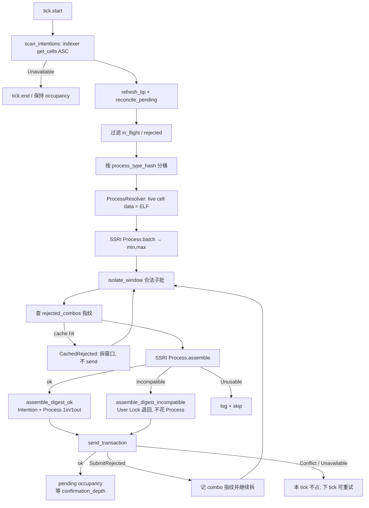

# ckb-cid-backend-server

CKB [Common Intention Dispatch (CID)](https://github.com/ashuralyk/ckb-common-intention-dispatcher) 的公共消化 daemon：按 indexer `asc` 扫描链上 Intention cell，进程内用 `cid-process-executor`（ckb-vm）对 live Process 二进制做 SSRI，组装并提交 Execution Tx。

本仓库与 [`ckb-common-intention-dispatcher`](https://github.com/ashuralyk/ckb-common-intention-dispatcher) **独立**（那边是协议、CID lock、executor、`cid_process_example`）。两边用 git 依赖与链上约定对接，不合并成一个 monorepo。

当前实现是 digest loop（v0）加上可选的 health/metrics HTTP。没有 admin API，没有磁盘状态。重启 = 全量 indexer 重扫。

## 文档

- 确认深度 / 重组 / 重试：[`docs/confirmation.md`](docs/confirmation.md)
- 日志、health、metrics：[`docs/observability.md`](docs/observability.md)
- 本地隔离 **dev** 链闭环：[`docs/local-dev-chain.md`](docs/local-dev-chain.md)
- 设计（历史拍板，部分 v0 范围已被后续阶段补上，以代码为准）：[`docs/superpowers/specs/2026-11-05-cid-backend-server-design.md`](docs/superpowers/specs/2026-11-05-cid-backend-server-design.md)
- 实现计划：[`docs/superpowers/plans/2026-11-05-cid-backend-server.md`](docs/superpowers/plans/2026-11-05-cid-backend-server.md)
- 真实 SSRI fixture：[`tests/fixtures/README.md`](tests/fixtures/README.md)

---

## 项目用途

Daemon 常驻消化 CID Intention：

1. 用 CID lock 的 `code_hash` / `hash_type` 从 indexer 拉 live Intention（`get_cells`，`order=asc`，分页直到耗尽）。
2. 解码 lock args 得到 `process_type_hash`，按该 hash 分桶。
3. 解析对应 live Process cell：生产路径只用 cell **data 里的 RISC-V ELF**（daemon **不**安装 Process 二进制 fallback）。
4. 进程内 SSRI：`Process.batch` 得到 `[min, max]`，`Process.assemble` 得到 partial tx。
5. 组装 Execution Tx 并 `send_transaction`：
   - **`digest_ok`**：销毁本批 Intention，Process **1 in / 1 out** 重建。不追加独立 fee / sponsor input；不把 User Lock 放进 inputs（Intention 创建后不再签名）。capacity 不够则跳过。
   - **`digest_incompatible`**：SSRI 返回 `Incompatible(code)` 时，把 Intention capacity 退回 args 里的 **User Lock**（不花 Process）。组不出来则打日志并跳过。
6. 提交成功后占用 spent inputs（以及 `digest_ok` 的 Process recreate），直到确认深度满足才释放。

不做：超时 burn 代发、多签 fee sponsor、官方 ssri-server、多实例协调、testnet/mainnet 运营脚本。

上游 git pin（`cid-process-executor` / `cid-protocol`）：`d9ee77805f7ac930ab149648bed70f484a9886de`。

---

## 如何运行

### 前置

- Rust **stable**（[`rust-toolchain.toml`](rust-toolchain.toml)），edition 2021；workspace `ckb-types` 0.119。
- 跑 daemon / FakeRpc 测试：只需 `cargo`。
- 跑 **真实 SSRI guest**（ckb-vm `Process.batch` / `Process.assemble`）：`clang-18`（或 `CLANG=clang`）+ `riscv64imac-unknown-none-elf`，用 [`scripts/build-cid-process-example.sh`](scripts/build-cid-process-example.sh) 生成 ELF。ELF **不**提交进 git。
- 本地隔离 dev 链闭环：再加 pinned `ckb` v0.119.0（脚本会下载）。**不是** testnet / mainnet。见 [`docs/local-dev-chain.md`](docs/local-dev-chain.md)。

### 构建

```bash
cargo build --locked -p cid-backend-daemon
```

### 配置（daemon 实际读取的环境变量）

`DaemonConfig::from_env()`（[`crates/cid-backend-daemon/src/config.rs`](crates/cid-backend-daemon/src/config.rs)）。缺必填项或非法值会打 `config.load_failed` 并 **exit 1**。

| 变量 | 必填 | 默认 / 含义 |
|------|------|-------------|
| `CID_CKB_RPC_URL` | 是 | 节点 JSON-RPC |
| `CID_INDEXER_URL` | 否 | Indexer JSON-RPC；空则同 `CID_CKB_RPC_URL` |
| `CID_LOCK_CODE_HASH` | 是 | CID lock `code_hash`，32 字节 hex（`0x` 可省略） |
| `CID_LOCK_HASH_TYPE` | 否 | `type`（默认）/ `data` / `data1` / `data2` |
| `CID_POLL_INTERVAL_SECS` | 是 | 每 tick 间隔，整数 **≥ 1** |
| `CID_LOCK_CELL_DEP` | 本地链常用 | `<tx_hash>:<index>` CID lock code cell（`DepType::Code`） |
| `CID_PROCESS_CODE_CELL_DEP` | 本地链常用 | Process ELF code cell |
| `CID_PROCESS_LOCK_CELL_DEP` | 本地链常用 | always-success code cell |
| `CID_EXTRA_CELL_DEPS` | 否 | 额外 `<tx_hash>:<index>`，逗号分隔 |
| `CID_PROCESS_CODE_HASH` | 本地链常用 | Process ELF **data hash**，作 indexer type-script 前缀；CID args 里是 `calc_script_hash`，不是 code hash。可逗号分隔多个 |
| `CID_HEALTH_BIND` | 否 | `host:port`（如 `127.0.0.1:9100`）；未设或空字符串则 **不** 开 HTTP |
| `CID_CONFIRMATION_DEPTH` | 否 | 已 committed 的 Execution Tx 再等多少块才 settle；默认 **24**，必须 **≥ 1** |
| `CID_LOG_FORMAT` | 否 | `json`（默认）或 `pretty`（`text` 是 pretty 的别名） |
| `RUST_LOG` | 否 | `tracing` EnvFilter，默认 `info` |

cell dep 格式：`<tx_hash>:<index>`，index 可以是十进制或 `0x` hex。上述四个 cell-dep 变量都会并入 `LoopConfig.extra_cell_deps`。

Daemon **不**读 `CID_PROCESS_EXAMPLE_PATH` / `CID_LOCAL_CHAIN_E2E`（那是测试 fixture / 本地链 E2E 开关）。生产 Process 二进制只来自 live Process cell data。`CkbRpc` 对 `CID_CKB_RPC_URL` / `CID_INDEXER_URL` 发 JSON-RPC；测试用内存 `FakeRpc`。

### 启动 daemon

```bash
export CID_CKB_RPC_URL=http://127.0.0.1:8114
export CID_LOCK_CODE_HASH=   # 32 字节 hex
export CID_POLL_INTERVAL_SECS=5
# 本地链还需 CID_LOCK_CELL_DEP / CID_PROCESS_* / CID_PROCESS_CODE_HASH，见 docs/local-dev-chain.md
cargo run -p cid-backend-daemon
```

`main` 每次 `tick()` 后 `thread::sleep(poll_interval)`。非法配置立即退出。

### 本地隔离 dev 链

不要连 public RPC。脚本会下载 pinned `ckb` v0.119.0、把 `min_fee_rate` 设为 **0**（digest tx 不加 fee input）、打开 Indexer 模块、编译 RISC-V guest、在 `127.0.0.1:8114` 起 `ckb run` + `ckb miner`，然后跑 ignored E2E：

```bash
./scripts/local-dev-chain.sh
```

等价于：

```bash
CID_LOCAL_CHAIN_E2E=1 cargo test -p cid-backend-daemon --test local_chain_e2e -- --ignored --nocapture
```

成功时打印 `local-chain execution tx committed:` 和 `local-chain closure ok:`。细节与本地链前提（Process data 必须是 ELF、Process lock 为 always-success、无 post-Intention 签名）见 [`docs/local-dev-chain.md`](docs/local-dev-chain.md)。

### Health / metrics

未设置 `CID_HEALTH_BIND` 则没有监听。开了之后 **不**阻塞 digest loop。

```bash
export CID_HEALTH_BIND=127.0.0.1:9100
cargo run -p cid-backend-daemon
curl -s http://127.0.0.1:9100/healthz    # 存活，进程在就 200
curl -s http://127.0.0.1:9100/readyz    # 最近一次 indexer scan 成功才 200，否则 503
curl -s http://127.0.0.1:9100/stats     # JSON 计数
curl -s http://127.0.0.1:9100/metrics   # Prometheus text
```

`127.0.0.1:0` 可用作临时端口；daemon 打 `health.listen` 带实际上绑定的地址。限制（最多 32 worker、读头 2s 截止、不收 body）见 [`docs/observability.md`](docs/observability.md)。

### 测试

默认 `cargo test` **不会**起 CKB 节点。CI（`.github/workflows/ci.yml`）在 `push` / `pull_request` / `workflow_dispatch` 上构建 `cid_process_example`，然后跑下面三条（与本地应对齐）：

```bash
cargo test --locked -p cid-backend-core -- --include-ignored --nocapture
cargo test --locked -p cid-backend-daemon -- --nocapture
cargo test --locked -p cid-backend-tests -- --nocapture
```

| 套件 | 内容 |
|------|------|
| `cid-backend-core --include-ignored` | 库单测 + **必须执行**的真实 SSRI guest（`real_example_binary_batch_bounds_and_assemble`）。ELF 缺失时该测试会 panic，而不是 skip 后仍 `ok`。 |
| `cid-backend-daemon` | HTTP mock：adapter 映射（含 `PoolIsFull` 重试 vs verify/malformed reject、未知 committed 高度 vs 显式 genesis 0）、indexer 分页、Pending/Dropped、health 限制。`local_chain_e2e` **ignored**。 |
| `cid-backend-tests` | FakeRpc 竖切：n=1 `digest_ok`、batch 边界、Incompatible 退回、conflict 重试、确认深度、reorg、Dropped/Unavailable、`SubmitRejected` combo 隔离与 starvation 回归。不连网。 |

默认本地 `cargo test -p cid-backend-core` **会 ignore** `real_example_binary_batch_bounds_and_assemble`（fixture 不在仓库里）。那次 `ignored` **不算**真实 SSRI 通过。要本地跑 guest：

```bash
./scripts/build-cid-process-example.sh
cargo test --locked -p cid-backend-core -- --include-ignored --nocapture
```

查找顺序：`CID_PROCESS_EXAMPLE_PATH`，然后 `tests/fixtures/cid_process_example`。FakeRpc 竖切用 `ScriptedSsri`，不需要 ELF。

唯一的真实本地链证据是 ignored `local_chain_e2e`（上面的 `./scripts/local-dev-chain.sh`）。

---

## 框架设计

### Crate 布局（Approach A）

| Crate | 角色 |
|-------|------|
| `crates/cid-backend-core` | 消化 pipeline 库：`scan` / `process` / `ssri` / `assemble` / `submit` / `digest_loop`。`Rpc` 是 trait。 |
| `crates/cid-backend-daemon` | 薄层：env 配置、`CkbRpc`（CKB JSON-RPC + Indexer）、可选 health HTTP、`main` 里 `tick` + sleep。业务规则在 core。 |
| `tests/`（`cid-backend-tests`） | FakeRpc 竖切；只依赖 core。 |

SSRI 宿主是进程内 `EmbeddedSsri`（`cid-process-executor`），不是外置 ssri-server。

### Digest loop



每个 tick（[`digest_loop.rs`](crates/cid-backend-core/src/digest_loop.rs)）：

1. 扫 live Intention，解码失败的 cell 跳过。
2. 刷新 tip；对 `pending` 里的 tx 问 `get_transaction_status`。`Committed` 后再读一次 tip：tip 回退、header/tip 不可用、或 `tip < commit_height` 则本 tick **不** settle（见 [`docs/confirmation.md`](docs/confirmation.md)）。
3. 按 Process 分桶；`isolate_window` 在 `[min, max]` 内拆批。
4. `digest_ok` 占用 Process recreate，直到 settle；同 tick 的 User Lock 退回仍可提交。

### 内存状态与重启

全部 bookkeeping 只在进程内存：`in_flight` / `pending` / `rejected_combos` / `isolate_resume` / `isolate_expanded` / health 计数。没有 SQLite / Redis / 游标文件。进程退出即丢失；下一 tick 从 indexer 头全量重扫。重启后仍在 mempool 的 tx 可能被再提交（D6）；已被花掉的 cell 会以 `Conflict` 出现。

### 确认深度与重组

`Committed` 不是第一次看见就 settle。占用保持到：

```
confirmations = 0                      若 tip < commit_block
              = tip - commit_block + 1  否则
confirmations >= CID_CONFIRMATION_DEPTH
```

默认 24 块（约 3 分钟 @ ~8s）。FakeRpc 与本地链 E2E 用 `1`。Tip 回退打 `reorg.tip_rewind`，确认数下降。确认中的 tx 变成 `Dropped` 则释放占用，cell 仍 live 则下 tick 重试。比 `CID_CONFIRMATION_DEPTH` 更深的重组、发生在 settle **之后**，是接受的残余风险。

### 重试 vs 永久失败

`CkbRpc` 保留 `send_transaction` 的 JSON-RPC `error.code`：

| 结果 | 是否重试 | 占用 |
|------|----------|------|
| `Dropped` | 是（cell 仍 live） | 释放 |
| RPC/indexer `Unavailable`（含 `-1106` PoolIsFull、`-1105` ancestors、`-1104` min fee、未分类） | 是 | 已 pending 则保持；提交失败不占 |
| `Conflict`（`-301`、`-1107`、unknown-input 等） | 是 | 不占 |
| `SubmitRejected`（`-302` / `-1102` / `-1108`） | 隔离该 **combo**，进程期内不再 send | 不占；不把 Process 写入 `rejected` |
| SSRI `Incompatible` | User Lock 退回 | 不花 Process |

缺 `block_hash` / `get_header` 返回 null 是 `Unavailable`，不会伪造 genesis 高度 0；显式 `block_number: 0x0` 才是 `Committed{0}`。

### Combo 隔离与预算

`SubmitRejected` 记的是 Intention outpoint **顺序**指纹；`digest_ok` 还带 Process outpoint，退回不带。同一 combo 直到重启（或 Process outpoint 变了）才可能再 send。窗口拆成合法 `[min, max]` 子批（缩前缀 + drop-first），`min = 1` 时有效兄弟仍可能提交。

- 每桶每 tick 最多 **64** 次新的 `send_transaction` 或 assemble-skip。`rejected_combos` 命中 **不** 消耗该预算。
- 另有每桶每 tick **256** 次 cached split，避免已拒绝窗口的指数钻石展开。
- 每个窗口指纹在一次 isolate sweep 里最多展开一次（`isolate_expanded`）。预算切断时与 resume 游标一起保留，下 tick 从剩余 unique 窗口继续，而不是从 ASC 头整树重走。
- 未缓存的 no-send skip（`RefundUnbuildable`、capacity shortfall、SSRI Unusable）计入 64 次工作上限，**不**写入 `rejected` / `rejected_combos`。
- `min > 1` 且无法再拆时，不把整窗写入 `rejected`；永远只和失败 A 成对出现的 B 可能一直提交不了——这是接受的，黑名单 B 更糟。

单例 `{A, Process}` 失败 **不能**证明 A 永久无效。细节见 [`docs/confirmation.md`](docs/confirmation.md)。

### 可观测性

Core 用 `tracing`（target `cid_backend`，稳定字段 `event`）。Daemon 用 `tracing-subscriber` JSON/pretty，并把剩余 `log::` 桥过去。

常见 `event`：`tick.start` / `tick.end`（含 `scanned` / `skipped` / `submitted` / `conflicts` / `scan_ok` / `isolate_windows`）、`scan.unavailable`、`submit.ok` / `submit.conflict` / `submit.rejected` / `submit.rejected_combo`、`pending.committed` / `pending.settled` / `pending.dropped` / `pending.reorg` / `pending.tip_rewind`、`reorg.tip_rewind`、`config.load_failed`。完整表见 [`docs/observability.md`](docs/observability.md) 与 [`docs/confirmation.md`](docs/confirmation.md) 的 Logs。
