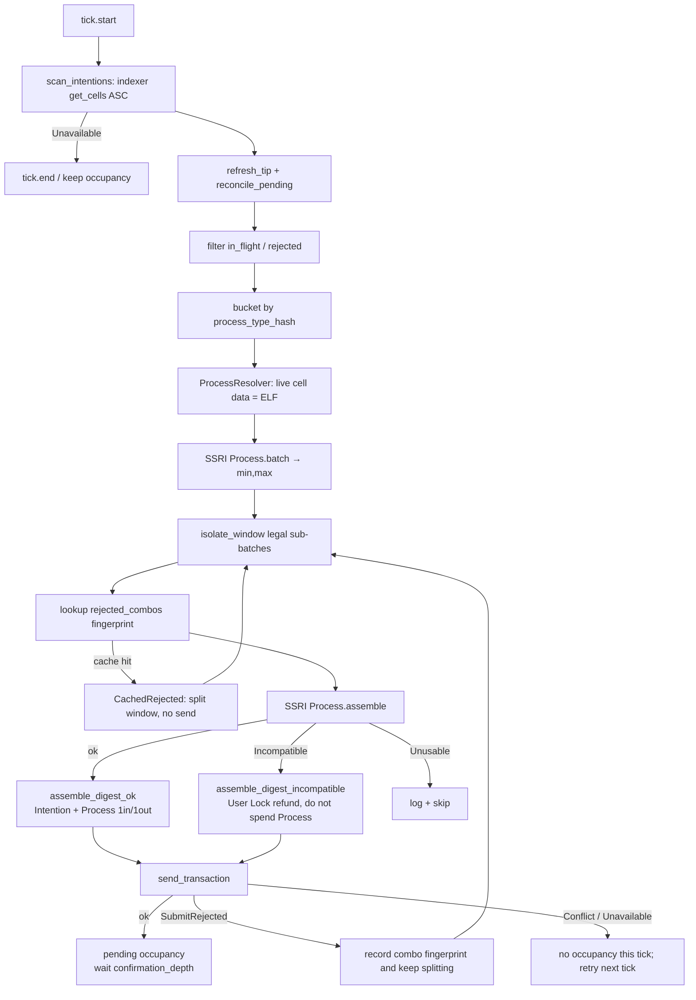

# ckb-cid-backend-server

Public digest daemon for CKB [Common Intention Dispatch (CID)](https://github.com/ashuralyk/ckb-common-intention-dispatcher): scan live Intention cells from the indexer in `asc` order, run SSRI in-process via `cid-process-executor` (ckb-vm) against the live Process binary, assemble and submit Execution Tx.

This repository is **independent** of [`ckb-common-intention-dispatcher`](https://github.com/ashuralyk/ckb-common-intention-dispatcher) (protocol, CID lock, executor, `cid_process_example`). Link them with git dependencies and on-chain conventions — do not merge the monorepos.

The current implementation is the digest loop (v0) plus optional health/metrics HTTP. No admin API, no disk state. Restart = full indexer rescan.

## Docs

- Confirmation depth / reorg / retry: [`docs/confirmation.md`](docs/confirmation.md)
- Logs, health, metrics: [`docs/observability.md`](docs/observability.md)
- Isolated local **dev** chain closure: [`docs/local-dev-chain.md`](docs/local-dev-chain.md)
- Design (historical decisions; some v0 scope was filled in later phases — the code wins): [`docs/superpowers/specs/2026-11-05-cid-backend-server-design.md`](docs/superpowers/specs/2026-11-05-cid-backend-server-design.md)
- Implementation plan: [`docs/superpowers/plans/2026-11-05-cid-backend-server.md`](docs/superpowers/plans/2026-11-05-cid-backend-server.md)
- Real SSRI fixture: [`tests/fixtures/README.md`](tests/fixtures/README.md)

---

## Purpose

The daemon continuously digests CID Intentions:

1. Fetch live Intentions from the indexer by CID lock `code_hash` / `hash_type` (`get_cells`, `order=asc`, paginate until exhausted).
2. Decode lock args to get `process_type_hash` and bucket by that hash.
3. Resolve the matching live Process cell. SSRI binary source: **Type-ID Process code** (when `process.type_id_args` is set) uses that code-cell ELF for the tick; otherwise legacy **state-cell data** ELF (local data1). The daemon does **not** install a Process-binary fallback.
4. In-process SSRI: `Process.batch` yields `[min, max]`; `Process.assemble` yields a partial tx.
5. Assemble an Execution Tx and `send_transaction`:
   - **`digest_ok`**: destroy this batch of Intentions; Process **1 in / 1 out** recreate. No extra fee / sponsor input; User Lock is not placed in inputs (no signature after Intention creation). Skip on capacity shortfall.
   - **`digest_incompatible`**: when SSRI returns `Incompatible(code)`, refund to the **User Lock** in args (does not spend Process). Exact **capacity** is copied, and original cell **data** is kept. Supported assets: pure CKB (no type script), or **standard xUDT** (official Data1 `XUDT_CODE_HASH` + 16-byte amount) which also keeps the type script. Any other type script, or xUDT data that is not 16 bytes, is `RefundUnbuildable`: log and skip. See `assemble.rs::refund_output`.
6. After a successful submit, occupy spent inputs (and the `digest_ok` Process recreate) until confirmation depth is met.

Out of scope: timeout-burn proxy, multi-sig fee sponsor, official ssri-server, multi-instance coordination, testnet/mainnet ops scripts.

Upstream git pin (`cid-process-executor` / `cid-protocol`): `d9ee77805f7ac930ab149648bed70f484a9886de`.

---

## How to run

### Prerequisites

- Rust **stable** ([`rust-toolchain.toml`](rust-toolchain.toml)), edition 2021; workspace `ckb-types` 0.119.
- Running the daemon / FakeRpc tests: `cargo` only.
- Running the **real SSRI guest** (ckb-vm `Process.batch` / `Process.assemble`): `clang-18` (or `CLANG=clang`) + `riscv64imac-unknown-none-elf`, via [`scripts/build-cid-process-example.sh`](scripts/build-cid-process-example.sh). The ELF is **not** committed.
- Isolated local dev-chain closure: pinned `ckb` v0.119.0. [`scripts/local-dev-chain.sh`](scripts/local-dev-chain.sh) **auto-downloads** the `x86_64-unknown-linux-gnu` binary only. Other platforms (macOS, ARM Linux) must place a matching `ckb` at `$CKB_DIR/ckb` (default `.local-ckb/ckb`). Also needs `python3`, `make`, `git`, `curl`, `tar`. **Not** testnet / mainnet. See [`docs/local-dev-chain.md`](docs/local-dev-chain.md).

### Build

```bash
cargo build --locked -p cid-backend-daemon
```

### Configuration

The daemon is **keyless** (no signing, no dotenv / `.env`). Public network, contract, and runtime settings go in a TOML file; legacy `CID_*` process environment variables still work and **override** the file when set and non-empty.

```bash
cargo run -p cid-backend-daemon -- --config examples/cid.network.toml.example
# or: CID_CONFIG=/path/to/cid.toml cargo run -p cid-backend-daemon
```

`--config PATH` wins over `CID_CONFIG`. If neither is set, behaviour is the previous env-only load (`DaemonConfig::from_vars`). Precedence: **built-in defaults < TOML file < explicit non-empty `CID_*` env**. Copy [`examples/cid.network.toml.example`](examples/cid.network.toml.example) and replace every `<PLACEHOLDER>` — that example is **not** valid hex/URLs and will not start.

`network.name` is a **log label only**. `network.genesis_hash` is the declared chain identity (that node’s `get_block_hash("0x0")`). File mode **requires** it (or `CID_GENESIS_HASH`). It is **not** verified unless `network.validate_genesis = true` (or `CID_VALIDATE_GENESIS=true`), in which case the daemon fail-closes on RPC error or mismatch. Logs use `genesis_status=declared_unverified` or `genesis.verified` accordingly.

**Type-ID code cells (preferred for `hash_type=type`):** configure `cid_lock.type_id_args` / `process.type_id_args` (and optional `process_lock.type_id_args`) — the 32-byte TYPE_ID **type-script args** on each **code** cell. Optional `type_id` is the full type-script hash for fail-closed verification; it is **not** args. The daemon derives `code_hash` for `hash_type=type`, finds the live code cell via indexer **exact** type-script search each tick (bounded uniqueness walk), and merges those CellDeps into assemble. When `process.type_id_args` is set, SSRI executes that Process **code** cell’s ELF for the tick (same outpoint as the CellDep)—not the Process **state** cell data. Legacy / local data1 mode (no Process Type-ID) still uses state-cell ELF. Missing / ambiguous / mismatched / transport / dep_type-conflict errors skip **new** assembly (retry next poll) and do **not** permanently reject Intentions; already-submitted txs still confirm/reorg-reconcile. Dispatcher deployment JSON is never auto-loaded. Live Process **state** cells are matched by CID args `process_type_hash` (full type script hash), distinct from the Process **code** cell TYPE_ID.

Static `[[cell_deps]]` / `CID_*_CELL_DEP` remain for **unrelated** extras (secp, xUDT, always-success). Configuring a Type-ID identity for a role **rejects** the matching static role dep (`CID_LOCK_CELL_DEP` / labeled `cid_lock`, etc.) so stale outpoints cannot survive upgrades. Unlabeled extras cannot be inferred as role code cells—do not put Type-ID role outpoints there unlabeled.

`config.loaded` logs `rpc` / `indexer` as scheme+host+port only (userinfo and path/query stripped).

`DaemonConfig` lives in [`crates/cid-backend-daemon/src/config.rs`](crates/cid-backend-daemon/src/config.rs). Missing required values or illegal config logs `config.load_failed` and **exits 1**.

#### Env vars (legacy; also file overrides)

| Variable | Config parser | Default / meaning |
|----------|---------------|-------------------|
| `CID_CKB_RPC_URL` | required | Node JSON-RPC |
| `CID_INDEXER_URL` | optional | Indexer JSON-RPC; empty uses `CID_CKB_RPC_URL` |
| `CID_LOCK_CODE_HASH` | required unless Type-ID | CID lock `code_hash`, 32-byte hex (`0x` optional); derived when `CID_LOCK_TYPE_ID_ARGS` is set |
| `CID_LOCK_HASH_TYPE` | optional | `type` (default) / `data` / `data1` / `data2`; Type-ID mode requires `type` |
| `CID_LOCK_TYPE_ID_ARGS` | optional | 32-byte TYPE_ID args for CID lock **code** cell |
| `CID_LOCK_TYPE_ID` | optional | Full type-script hash verify (not args) |
| `CID_PROCESS_TYPE_ID_ARGS` | optional | TYPE_ID args for Process **code** cell |
| `CID_PROCESS_TYPE_ID` | optional | Full type-script hash verify for Process code |
| `CID_PROCESS_LOCK_TYPE_ID_ARGS` | optional | TYPE_ID args for Process lock code cell |
| `CID_PROCESS_LOCK_TYPE_ID` | optional | Full type-script hash verify for Process lock code |
| `CID_POLL_INTERVAL_SECS` | required | Seconds between ticks, integer **≥ 1** |
| `CID_LOCK_CELL_DEP` | optional static | `<tx_hash>:<index>` when not using Type-ID discovery |
| `CID_PROCESS_CODE_CELL_DEP` | optional static | Process type code cell outpoint (static mode) |
| `CID_PROCESS_LOCK_CELL_DEP` | optional static | Process lock code cell (local-chain: always-success) |
| `CID_EXTRA_CELL_DEPS` | optional | Extra `<tx_hash>:<index>` list, comma-separated |
| `CID_PROCESS_CODE_HASH` | optional | Indexer type-script **code_hash prefix** for live Process cells; Type-ID mode auto-adds the derived Process code `type_id` |
| `CID_HEALTH_BIND` | optional | `host:port` (e.g. `127.0.0.1:9100`); unset or empty **disables** HTTP |
| `CID_CONFIRMATION_DEPTH` | optional | Blocks after a committed Execution Tx before settle; default **24**, must be **≥ 1** |
| `CID_LOG_FORMAT` | optional | `json` (default) or `pretty` (`text` is an alias for pretty) |
| `CID_CONFIG` | optional | TOML path if `--config` is omitted |
| `CID_GENESIS_HASH` | optional | Overrides `network.genesis_hash` |
| `CID_VALIDATE_GENESIS` | optional | `true`/`false`; overrides `network.validate_genesis` |
| `RUST_LOG` | optional | `tracing` EnvFilter, default `info` |

Cell-dep format: `<tx_hash>:<index>`; index may be decimal or `0x` hex. Static cell-dep variables merge into `LoopConfig.extra_cell_deps`. Type-ID deps are resolved each tick and merged first (deduped by outpoint).

`CID_PROCESS_CODE_HASH` is not a local-chain-only switch. `CkbRpc::get_live_process_by_type_hash` always searches indexer type prefixes from that list (plus a prefix search on the args `process_type_hash` itself), then filters `calc_script_hash`. The args hash is a full script hash, so using it as a type `code_hash` prefix usually finds nothing — set the Process type's actual `code_hash` (or use Process `type_id_args` so it is derived).

The daemon does **not** read `CID_PROCESS_EXAMPLE_PATH` / `CID_LOCAL_CHAIN_E2E` (test fixture / local-chain E2E switch). Production Process binaries come only from live Process cell data. `CkbRpc` talks JSON-RPC to `CID_CKB_RPC_URL` / `CID_INDEXER_URL`; tests use in-memory `FakeRpc`.

### Start the daemon

```bash
export CID_CKB_RPC_URL=http://127.0.0.1:8114
export CID_POLL_INTERVAL_SECS=5
# Type-ID (preferred on hash_type=type networks):
#   CID_LOCK_TYPE_ID_ARGS / CID_PROCESS_TYPE_ID_ARGS (+ optional *_TYPE_ID)
# Or legacy static: CID_LOCK_CODE_HASH + CID_*_CELL_DEP + CID_PROCESS_CODE_HASH
# See docs/local-dev-chain.md for the local data1 fixture path.
cargo run -p cid-backend-daemon
# same settings in TOML: cargo run -p cid-backend-daemon -- --config path/to/cid.toml
```

`main` sleeps `poll_interval` after each `tick()`. Illegal config exits immediately. `--help` prints the flag list.

### Isolated local dev chain

Do not use public RPC. The supported entry is:

```bash
./scripts/local-dev-chain.sh
```

That script: auto-downloads pinned `ckb` v0.119.0 **only** as `x86_64-unknown-linux-gnu` (skip download if `$CKB_DIR/ckb` is already executable; default `CKB_DIR=.local-ckb`); inits `dev` with genesis miner lock; sets `min_fee_rate` to **0** (digest tx has no fee input); enables the Indexer module; builds RISC-V guests (`clang-18` / `CLANG`, `git`, `make`, `python3`); starts `ckb run` + `ckb miner` on `127.0.0.1:8114`; exports `CID_CKB_RPC_URL`, `CID_PROCESS_EXAMPLE_PATH`, `CID_LOCK_ELF_PATH`, `CID_ALWAYS_SUCCESS_PATH`, `CID_LOCAL_CHAIN_E2E=1`; then runs:

```bash
cargo test -p cid-backend-daemon --test local_chain_e2e -- --ignored --nocapture
```

The cargo line is **not** equivalent by itself. On a clean machine it fails without the node and those paths (`local_chain_e2e.rs`). On macOS / ARM Linux, install a matching `ckb` v0.119.0 into `$CKB_DIR/ckb` first. Also needs `curl` and `tar` for the Linux x86_64 download path.

Success prints `local-chain execution tx committed:` and `local-chain closure ok:`. Details (Process data must be an ELF, Process lock is always-success, no post-Intention signature) are in [`docs/local-dev-chain.md`](docs/local-dev-chain.md).

### Health / metrics

Unset `CID_HEALTH_BIND` means no listener. When enabled it does **not** block the digest loop.

```bash
export CID_HEALTH_BIND=127.0.0.1:9100
cargo run -p cid-backend-daemon
curl -s http://127.0.0.1:9100/healthz    # liveness: 200 while the process is up
curl -s http://127.0.0.1:9100/readyz    # 200 after a successful indexer scan, else 503
curl -s http://127.0.0.1:9100/stats     # JSON counters
curl -s http://127.0.0.1:9100/metrics   # Prometheus text
```

`127.0.0.1:0` binds an ephemeral port; the daemon logs `health.listen` with the bound address. Limits (at most 32 workers, 2s header-read deadline, no request body) are in [`docs/observability.md`](docs/observability.md).

### Tests

Default `cargo test` does **not** start a CKB node. CI (`.github/workflows/ci.yml`) on `push` / `pull_request` / `workflow_dispatch` builds `cid_process_example`, then runs these three (match them locally):

```bash
cargo test --locked -p cid-backend-core -- --include-ignored --nocapture
cargo test --locked -p cid-backend-daemon -- --nocapture
cargo test --locked -p cid-backend-tests -- --nocapture
```

| Suite | Coverage |
|-------|----------|
| `cid-backend-core --include-ignored` | Library unit tests plus the **must-execute** real SSRI guest (`real_example_binary_batch_bounds_and_assemble`). Missing ELF panics; a skip that still prints `ok` is not allowed. |
| `cid-backend-daemon` | HTTP mock: adapter mapping (including `PoolIsFull` retry vs verify/malformed reject, unknown committed height vs explicit genesis 0), indexer pagination, Pending/Dropped, health limits. `local_chain_e2e` is **ignored**. |
| `cid-backend-tests` | FakeRpc verticals: n=1 `digest_ok`, batch bounds, Incompatible refund, conflict retry, confirmation depth, reorg, Dropped/Unavailable, `SubmitRejected` combo isolation and starvation regressions. No network. |

Default local `cargo test -p cid-backend-core` **ignores** `real_example_binary_batch_bounds_and_assemble` (fixture is not in git). That `ignored` count is **not** a real-SSRI pass. To run the guest locally:

```bash
./scripts/build-cid-process-example.sh
cargo test --locked -p cid-backend-core -- --include-ignored --nocapture
```

Lookup order: `CID_PROCESS_EXAMPLE_PATH`, then `tests/fixtures/cid_process_example`. FakeRpc verticals use `ScriptedSsri` and do not need the ELF.

The only real local-chain evidence is ignored `local_chain_e2e` (`./scripts/local-dev-chain.sh` above).

---

## Architecture / design

### Crate layout (Approach A)

| Crate | Role |
|-------|------|
| `crates/cid-backend-core` | Digest pipeline library: `scan` / `process` / `ssri` / `assemble` / `submit` / `digest_loop`. `Rpc` is a trait. |
| `crates/cid-backend-daemon` | Thin layer: env config, `CkbRpc` (CKB JSON-RPC + Indexer), optional health HTTP, `tick` + sleep in `main`. Business rules stay in core. |
| `tests/` (`cid-backend-tests`) | FakeRpc verticals; depends on core only. |

The SSRI host is in-process `EmbeddedSsri` (`cid-process-executor`), not an external ssri-server.

### Digest loop



Each tick ([`digest_loop.rs`](crates/cid-backend-core/src/digest_loop.rs)):

1. Scan live Intentions; skip cells whose lock args fail to decode.
2. Refresh tip; ask `get_transaction_status` for txs in `pending`. After `Committed`, re-read tip: if the tip rewound, header/tip is unavailable, or `tip < commit_height`, do **not** settle this tick (see [`docs/confirmation.md`](docs/confirmation.md)).
3. Bucket by Process; `isolate_window` splits into legal `[min, max]` sub-batches.
4. `digest_ok` occupies the Process recreate until settle; User Lock refunds in the same tick may still submit.

### Memory-only state and restart

All bookkeeping is process memory: `in_flight` / `pending` / `rejected_combos` / `isolate_resume` / `isolate_expanded` / health counters. No SQLite / Redis / cursor file. It is dropped on exit; the next tick is a full indexer rescan from the head. After restart, a still-mempool tx may be submitted again (D6); already-spent cells surface as `Conflict`.

### Confirmation depth and reorg

`Committed` is not settled on first sight. Occupancy is held until:

```
confirmations = 0                      if tip < commit_block
              = tip - commit_block + 1  otherwise
confirmations >= CID_CONFIRMATION_DEPTH
```

Default is 24 blocks (~3 minutes at ~8s). FakeRpc and the local-chain E2E use `1`. A tip rewind logs `reorg.tip_rewind` and drops the confirmation count. A confirming tx that becomes `Dropped` releases occupancy and retries next tick if the cells are still live. A reorg deeper than `CID_CONFIRMATION_DEPTH` **after** settlement is accepted residual risk.

### Retry vs permanent failure

`CkbRpc` keeps the JSON-RPC `error.code` from `send_transaction`:

| Outcome | Retry? | Occupancy |
|---------|--------|-----------|
| `Dropped` | yes (if cells still live) | released |
| RPC/indexer `Unavailable` (including `-1106` PoolIsFull, `-1105` ancestors, `-1104` min fee, unclassified) | yes | held if already pending; not taken on a failed submit |
| `Conflict` (`-301`, `-1107`, unknown-input, etc.) | yes | not taken |
| `SubmitRejected` (`-302` / `-1102` / `-1108`) | isolate that **combo**; do not send it again this process lifetime | not taken; Process is not written to `rejected` |
| SSRI `Incompatible` | User Lock refund | does not spend Process |

Missing `block_hash` / `get_header` returning null is `Unavailable`, not fabricated genesis height 0; explicit `block_number: 0x0` is `Committed{0}`.

### Combo isolation and budgets

`SubmitRejected` records a fingerprint of Intention outpoints **in order**; `digest_ok` also includes the Process outpoint, refunds omit it. The same combo is not sent again until restart (or the Process outpoint changes). The window is split into legal `[min, max]` sub-batches (shrink prefix + drop-first) so a valid sibling can still submit when `min = 1`.

- At most **64** new `send_transaction` or assemble-skip attempts per bucket per tick. Hits on `rejected_combos` do **not** consume that budget.
- A separate cap of **256** cached splits per bucket per tick bounds exponential diamond expansion of already-rejected windows.
- Each window fingerprint is expanded at most once per isolate sweep (`isolate_expanded`). When a budget cuts the tick, that set is kept with the resume cursor so the next tick continues remaining unique windows instead of re-walking the tree from the ASC head.
- Uncached no-send skips (`RefundUnbuildable`, capacity shortfall, SSRI Unusable) count toward the 64 work bound and are **not** written to `rejected` / `rejected_combos`.
- When `min > 1` and the window cannot split further, members are not written wholesale into `rejected`; a valid B that only ever appears next to a failing A may stay unsubmitted — accepted; blacklisting B would be worse.

A singleton `{A, Process}` failure does **not** prove A is permanently invalid. Details: [`docs/confirmation.md`](docs/confirmation.md).

### Observability

Core uses `tracing` (target `cid_backend`, stable field `event`). The daemon uses `tracing-subscriber` JSON/pretty and bridges remaining `log::` calls.

Common `event` values: `tick.start` / `tick.end` (with `scanned` / `skipped` / `submitted` / `conflicts` / `scan_ok` / `isolate_windows`), `scan.unavailable`, `submit.ok` / `submit.conflict` / `submit.rejected` / `submit.rejected_combo`, `pending.committed` / `pending.settled` / `pending.dropped` / `pending.reorg` / `pending.tip_rewind`, `reorg.tip_rewind`, `config.load_failed`. Full tables: [`docs/observability.md`](docs/observability.md) and the Logs section of [`docs/confirmation.md`](docs/confirmation.md).
